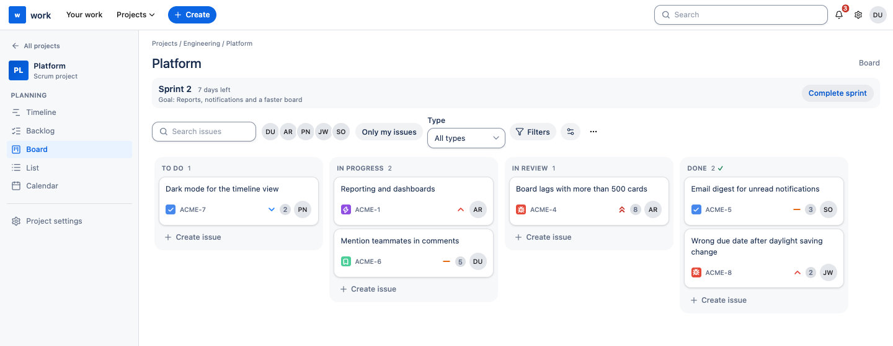
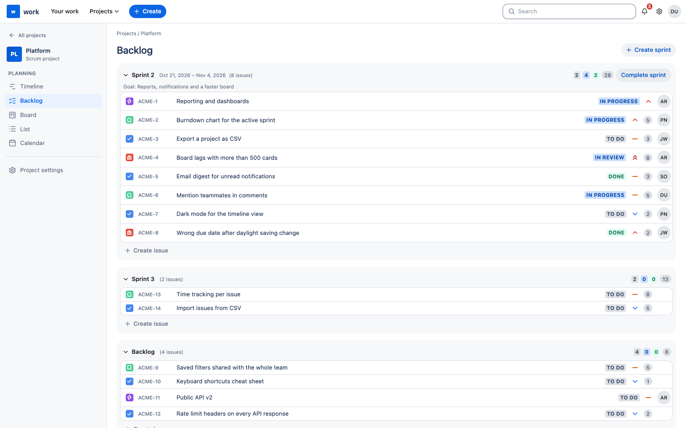
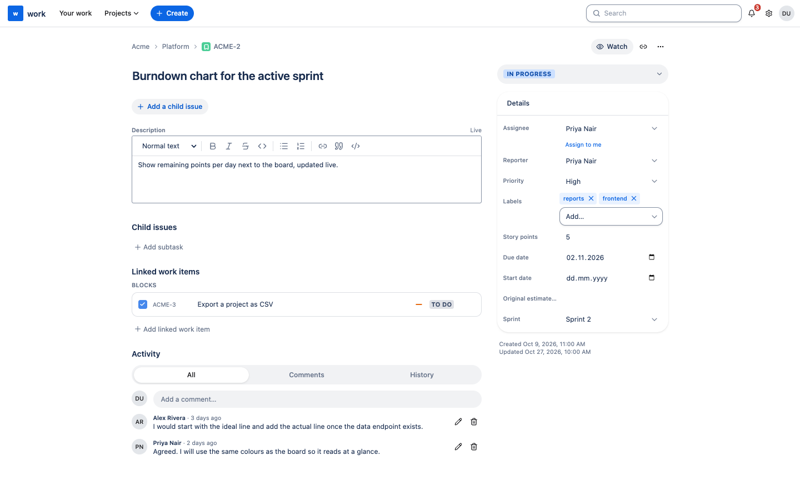

<div align="center">


# work

**Work management you host yourself.** Boards, backlog and sprints, issues that several people edit at once,
automations, an AI assistant on your own hardware and an MCP server for your AI agents.

[](https://github.com/EversIT/work/actions/workflows/ci.yml)
[](https://github.com/EversIT/work/releases)
[](https://hub.docker.com/r/eversit/work-backend)
[](LICENSE)

[**Install**](apps/docs/src/install.md) · [**Docs**](https://eversit.github.io/work/) · [**Try the demo**](#try-it-in-ten-seconds) · [**Download**](#download) · [**API**](#using-the-api)

<picture>
  <source media="(prefers-color-scheme: dark)" srcset="apps/docs/src/public/screenshots/board-dark.png">
  
</picture>

</div>

## What it is

work is an open-source, self-hosted tool in the spirit of Jira Cloud: **projects** with a board, backlog and sprints,
**issue keys** such as `WORK-12`, types, priorities and story points, and rich-text descriptions. It is a
**Rust** backend (Axum, SQLx, PostgreSQL) and a **Next.js** frontend on **HeroUI v3**, shipped as two small images
plus PostgreSQL. Your data stays on your server.

|                                                                               |                                                                                                    |
| ----------------------------------------------------------------------------- | -------------------------------------------------------------------------------------------------- |
| 🗂️ **Boards, backlog, list, table, calendar, timeline**, Kanban or Scrum      | 🤖 **AI on your own hardware**: off until you connect a model, no cloud, no API key                |
| ✍️ **Live editing**: several people in one description, comments, attachments | 🔌 **MCP server**: Claude Code, Cursor and other agents work with your issues and your permissions |
| ⚙️ **Automations** with triggers, actions, webhooks and e-mail                | 🔐 **Passkeys, authenticator codes, SSO** (Google, GitHub, Microsoft, Slack, OIDC, SAML)           |
| 🌍 **English and German**, light and dark                                     | 🧰 **Documented REST API** with personal tokens, files on disk, S3 or Azure                        |

## Screenshots

<table>
  <tr>
    <td width="50%"><br><sub><b>Backlog and sprints</b>: plan a sprint, drag issues in, complete it.</sub></td>
    <td width="50%"><br><sub><b>Issues</b>: rich text, fields, links between issues, history and comments.</sub></td>
  </tr>
</table>

## Try it in ten seconds

The demo is the real frontend with made-up data in the browser: no backend, no database, nothing is stored.

```sh
docker run --rm -p 3000:3000 -e DEMO_MODE=true eversit/work-frontend
```

Open <http://localhost:3000>.

## Install

You need a Linux host with Docker (Engine 24+ with the Compose plugin) and 2 GB of RAM.

```sh
mkdir work && cd work
curl -fsSLO https://raw.githubusercontent.com/EversIT/work/main/packages/deploy/docker-compose.yml
curl -fsSL  https://raw.githubusercontent.com/EversIT/work/main/packages/deploy/.env.example -o .env
```

Fill in `.env`: the image versions, the database password, and two secrets you generate yourself. Compose refuses
to start without them, because there are no default secrets.

```sh
openssl rand -hex 24      # POSTGRES_PASSWORD
openssl rand -base64 48   # WORK_JWT_SECRET
docker compose up -d
```

Open <http://127.0.0.1:3000> and register: **the first account is the instance administrator.** Put a
TLS-terminating reverse proxy in front for anything beyond a trial and set `WORK_FRONTEND_URL` to the public
`https://` address. The full guide, with HTTPS, backups and upgrades, is in the
[installation guide](apps/docs/src/install.md).

## Download

| What                  | Where                                                                                                  | Use it for                                  |
| --------------------- | ------------------------------------------------------------------------------------------------------ | ------------------------------------------- |
| **Backend image**     | [`eversit/work-backend`](https://hub.docker.com/r/eversit/work-backend) on Docker Hub (amd64, arm64)   | The API; runs its migrations at start       |
| **Frontend image**    | [`eversit/work-frontend`](https://hub.docker.com/r/eversit/work-frontend) on Docker Hub (amd64, arm64) | The web app; also the demo with `DEMO_MODE` |
| **Compose file**      | [`packages/deploy`](packages/deploy)                                                                   | Backend, frontend and PostgreSQL together   |
| **Releases, changes** | [GitHub releases](https://github.com/EversIT/work/releases)                                            | Release notes and version history           |
| **Source**            | `git clone https://github.com/EversIT/work`                                                            | Build it yourself, see below                |

Every release publishes the tags `X.Y.Z`, `X.Y`, `X` and `latest`. Use the exact version in production, and run
backend and frontend at the **same** version.

## AI assistant and MCP

- **AI assistant.** Off until an admin enters a self-hosted language model (llama.cpp, Ollama, vLLM, ...) under
  **Administration → AI**. Then it helps to write, improve and translate text, summarizes issues, boards and sprints,
  finds related issues and likely duplicates, and suggests field values, child issues and replies. A person always
  confirms a suggestion. Nothing goes to a cloud service. [How to set it up](apps/docs/src/ai.md)
- **MCP server** at `/api/v1/mcp`. AI agents search, read, create, update, move and comment on issues with a personal
  API token and exactly your permissions. **Account settings → API tokens** shows the address, the command to connect
  Claude Code and the list of tools. It works whether or not the assistant is on.

## Features

- **Projects** (Kanban or Scrum), created in one step, grouped in spaces (public or private with per-user grants)
  inside workspaces with an issue key prefix. Roles per project: viewer, member, admin, owner.
- **Board, backlog, list, table, calendar and timeline.** Drag and drop between statuses and sprints; group list
  and table by status or any field.
- **Issues** with type, summary, rich-text description (live editing by several people), assignee, reporter,
  priority, labels, story points, dates, child issues, links, comments with formatting and attachments, history,
  watchers and notifications (live, e-mail, Slack). Custom issue types and fields, and contact, company and
  deal layouts for light CRM use.
- **Search and filters** from the top bar, quick filters and saved filters per view.
- **Automations:** triggers (issue created, field changed, status changed, comment, assignee changed, a date
  arrives, incoming webhook) and actions (set field, move, assign, comment, create issue, send webhook, send e-mail).
- **Sign-in:** password with a policy and lock-out, **passkeys (WebAuthn)**, **authenticator-app codes**,
  e-mail confirmation, and single sign-on with **Google, GitHub, Microsoft, Slack, any OpenID Connect provider
  and SAML 2.0**.
- **Administration:** the instance's name, description, favicon and accent colour, an overview of users, projects
  and settings, user management, the AI model and an audit log.
- **Files** on local disk, S3 (or compatible) or Azure Blob Storage.

## Using the API

Everything the UI does is a documented REST call. The OpenAPI document is at `/api/v1/openapi.json`.

```sh
curl -H "Authorization: Bearer wrk_…" https://work.example.com/api/v1/me
curl -u you@example.com:wrk_… https://work.example.com/api/v1/projects
curl -X POST -H "Authorization: Bearer wrk_…" -H "content-type: application/json" \
     -d '{"data":{"title":"Created through the API"}}' https://work.example.com/api/v1/lists/<list-id>/cards
```

Tokens are read-only or read-write, can expire, act with your permissions and can be revoked at any time.
Managing tokens, passwords and the account itself needs a browser session.

## Build it yourself

Requirements: Node 24+, Rust (via [rustup](https://rustup.rs)), PostgreSQL 15+, Docker for images and tests.

```sh
npm ci
cp packages/deploy/.env.example .env     # fill in the required values; there are no defaults for secrets
npx nx run backend:serve                 # needs the WORK_* variables from .env in its environment
npx nx run frontend:dev
```

To build the images and start them: `npx nx run-many -t container:local`, then
`docker compose -f packages/deploy/docker-compose.yml --env-file .env up`. Compose publishes only `127.0.0.1:3000`.

## Documentation

|                                                                    |                                                         |
| ------------------------------------------------------------------ | ------------------------------------------------------- |
| [apps/docs/src/install.md](apps/docs/src/install.md)               | install with Docker, HTTPS, first sign-in               |
| [apps/docs/src/DEVELOPMENT.md](apps/docs/src/DEVELOPMENT.md)       | set up, tests, conventions, recipes                     |
| [apps/docs/src/ARCHITECTURE.md](apps/docs/src/ARCHITECTURE.md)     | how the code is organised and why                       |
| [apps/docs/src/CONFIGURATION.md](apps/docs/src/CONFIGURATION.md)   | every environment variable                              |
| [apps/docs/src/ai.md](apps/docs/src/ai.md)                         | the AI assistant and the MCP server                     |
| [apps/docs/src/SECURITY-MODEL.md](apps/docs/src/SECURITY-MODEL.md) | how it is protected, and what is left                   |
| [apps/docs/src/DATA-MIGRATION.md](apps/docs/src/DATA-MIGRATION.md) | importing from the NestJS/Vue project this derives from |
| [CONTRIBUTING.md](CONTRIBUTING.md)                                 | how to contribute                                       |
| [SECURITY.md](SECURITY.md)                                         | how to report a vulnerability                           |

The site in `apps/docs` is a [VitePress](https://vitepress.dev) project: `npx nx run docs:dev` to write,
`npx nx run docs:build` to build. The **docs** workflow publishes it to GitHub Pages.

## Publishing images and releases

Images are published to Docker Hub as `eversit/work-backend` and `eversit/work-frontend`. Releases are cut from
`main` on a maintainer's machine: `npx nx release` derives the next version from the conventional commits, tags
`vX.Y.Z`, pushes the tag and creates the GitHub release (it needs a personal `GITHUB_TOKEN` or `GH_TOKEN`; the first
release needs `--first-release`). Publishing the release starts the **publish** workflow, which pushes the images as
`X.Y.Z`, `X.Y`, `X` and `latest` (no branch tag). A manual run of **publish** on a tag (`build_all` ticked) pushes them again.

One-time setup: create the two public repositories on Docker Hub, and add the repository secrets
`DOCKERHUB_USERNAME` and `DOCKERHUB_TOKEN` (an access token with Read & Write). To publish somewhere else, set the
repository variables `IMAGE_REGISTRY` and `IMAGE_NAMESPACE`.

## License

MIT, see [LICENSE](LICENSE). The license keeps the copyright notice of the original project this code derives
from, as the MIT license requires.
